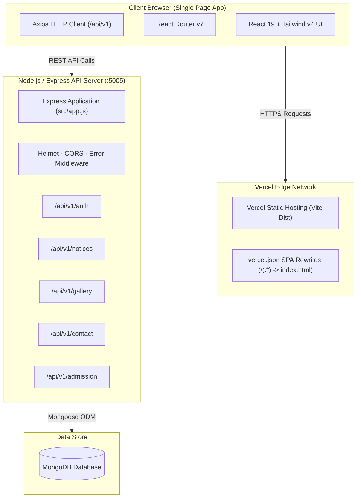

<div align="center">

# 🏫 Children's Happy Home (CHH)
### Comprehensive School Management System & Official Portal

[](https://react.dev/)
[](https://vitejs.dev/)
[](https://tailwindcss.com/)
[](https://nodejs.org/)
[](https://chh-school-management-system.vercel.app)
[](https://cbse.gov.in/)

<p align="center">
  <b>Official web portal and role-based School Management System (SMS) for Children's Happy Home, Katihar, Bihar.</b><br/>
  <i>Established in 1972 · Affiliation No. 330759 · School Code 65759 · Societies Registration Act 1861</i>
</p>

[🌐 Live Production Website](https://chh-school-management-system.vercel.app) · [📑 Project Architecture](#system-architecture) · [🚀 Setup Guide](#getting-started) · [📡 API Documentation](#api-endpoints)

</div>

---

## 📌 Table of Contents
- [About the Institution & Project](#about-the-institution--project)
- [Key Features](#key-features)
  - [1. Public Informational Portal](#1-public-informational-portal)
  - [2. Role-Based School Portal (SMS)](#2-role-based-school-portal-sms)
- [Live Demo & Pages Overview](#live-demo--pages-overview)
- [Technology Stack](#technology-stack)
- [System Architecture](#system-architecture)
- [REST API Documentation](#api-endpoints)
- [Directory Structure](#directory-structure)
- [Getting Started](#getting-started)
- [Deployment Configuration](#deployment-configuration)
- [Author & Acknowledgments](#author--acknowledgments)

---

## 🏫 About the Institution & Project

**Children's Happy Home (CHH)** is one of the oldest and most prestigious educational institutions in Katihar, Bihar, providing quality, holistic CBSE education for over five decades.

This repository hosts the full-stack web application comprising:
1. **Public Web Experience:** Comprehensive portal for prospective parents, students, alumni, and educational regulators (CBSE Appendix-IX Mandatory Public Disclosure).
2. **Student & Faculty Management Portal:** Role-scoped authentication for students, teachers, and non-teaching personnel (drivers, security, librarians).
3. **Enterprise Security Separation:** Administrative capabilities are architected for an isolated subdomain (`admin.childrenshappyhome.com/login`), isolating administrative operations from public vectors.

---

## ✨ Key Features

### 1. Public Informational Portal
- **Interactive Hero & Live Metric Counters:** Highlighting 50+ Years of legacy, 100% CBSE board pass rate, 1,500+ active students, and 50+ qualified educators.
- **Institutional History & Milestone Timeline:** Documenting institutional evolution from 1972 foundation by Late Shri Narayan Prasad Sharma to modern digital integration in 2026.
- **Leadership Messages with Interactive Modals:** Side-by-side statements from **President Shri Ashok Agarwal (M.L.C.)** and **Secretary Shri Gopal Soni** with complete English translations and expandable reading dialogs.
- **Academic Programs & Policies:** 7-tab deep-linked policy browser covering Academic Structure, School Timings, Uniform Regulations, Vacation Calendars, CBSE Examination Scheme, Discipline Codes, and complete 2026–27 Fee Structures.
- **Searchable Notice Board:** Live search with instant filtering across multiple categories (`General`, `Admission`, `Examination`, `Holiday`, `Event`, `CBSE`, `Important`) with modal announcements and document downloads.
- **Dynamic "Life at CHH" Photo Gallery:** Category filtering across Campus, Events, Sports, Classrooms, and Annual Functions with a custom full-screen Lightbox photo preview.
- **Admissions & Direct Contact Desk:** Integrated contact channels, interactive message dispatch, and one-click direct WhatsApp admission inquiries.
- **CBSE Corner (Mandatory Public Disclosure):** Formal compliance table matching CBSE Appendix-IX norms (Affiliation letter, Society registration, Building safety, Fire safety, and Water/Sanitation certifications).

### 2. Role-Based School Portal (SMS)
- **Scoped Public Roles:**
  - **🎓 Student Portal:** Access grades, continuous assessments, attendance tracking, monthly fees status, and examination timetables.
  - **👨‍🏫 Faculty & Staff Portal:** Tailored interface for teachers, librarians, and administrative staff.
  - **🚌 Non-Teaching Personnel Demonstrators:** Quick access switches for Bus Drivers (route logistics), Security Personnel, and Support Staff.
- **Security-Isolated Administration:** Admin controls are decoupled from public routes to prevent unauthorized access.
- **Client-Side Resiliency:** All frontend components feature graceful fallbacks to ensure uninterrupted rendering even when backend endpoints undergo maintenance.

---

## 🖥️ Live Demo & Pages Overview

| Route | Page | Description |
| :--- | :--- | :--- |
| `/` | **Home Page** | Hero, About snapshot, 6-card infrastructure grid, Principal carousel, notices widget & admission callout. |
| `/About` | **About Us** | Institutional vision, mission, core values, 1972–2026 timeline & leadership messages. |
| `/Academics` | **Academic Programs** | Programs grid & 2026–27 Fee Structure table with `?tab=fee-structure` deep-linking. |
| `/Facilities` | **Campus Facilities** | Science labs, digital library, hi-tech computer lab, athletic turf, and GPS bus transport. |
| `/Gallery` | **Life at CHH** | Filterable photo gallery with full-screen Lightbox modal viewer. |
| `/Notices` | **Notice Board** | Real-time search, category chips, high-priority tags, and notice detail modal. |
| `/CBSE_Corner` | **CBSE Disclosure** | Appendix-IX Mandatory Public Disclosure compliant transparency tables. |
| `/Contact` | **Contact & Inquiries** | Campus address, office hours, WhatsApp desk, and interactive enquiry dispatch form. |
| `/login` | **Portal Sign-In** | 2-Role authentication selection screen (Student / Faculty). |

---

## 🛠️ Technology Stack

### Frontend Architecture
- **Framework:** [React 19](https://react.dev/) (`19.3.0`)
- **Build System:** [Vite 7](https://vitejs.dev/) (`7.1.7`) with `@vitejs/plugin-react`
- **Styling:** [Tailwind CSS v4](https://tailwindcss.com/) (`4.3.3`) using `@theme` CSS tokens
- **Routing:** [React Router DOM v7](https://reactrouter.com/) (`7.18.3`) with `createBrowserRouter`
- **HTTP Client:** [Axios](https://axios-http.com/) (`1.20.0`) with `withCredentials: true`
- **Icons & Graphics:** Custom high-precision inline SVG vector graphics and official school crest emblem

### Backend Architecture
- **Runtime:** [Node.js](https://nodejs.org/) (ES6+ / CommonJS)
- **Web Framework:** [Express.js](https://expressjs.com/)
- **Database:** [MongoDB](https://www.mongodb.com/) with [Mongoose](https://mongoosejs.com/)
- **Security & Middleware:** Helmet, CORS, centralized Error Handling middleware

### Design Tokens & Brand Palette
- **Amber Primary:** `#D97706` (Hover: `#B45309`)
- **Gold Accent:** `#EAB308` (Hover: `#CA8A04`)
- **Navy Primary / Dark:** `#0F172A` / `#0B1528` / `#0B132B`
- **Page Canvas:** `#FAF9F6` / `#FAF5ED`

---

## 📐 System Architecture



---

## 📡 API Endpoints

The API is prefixed with `/api/v1`:

| Method | Endpoint | Description | Auth Required |
| :--- | :--- | :--- | :--- |
| `GET` | `/notices` | Retrieve all public notice board announcements | No |
| `GET` | `/notices/:id` | Retrieve single notice details by ID | No |
| `GET` | `/gallery` | Retrieve gallery image items (optional `?category=...`) | No |
| `GET` | `/admission` | Retrieve admission status, title, and session info | No |
| `POST` | `/contact` | Submit general or admission enquiry message | No |
| `POST` | `/auth/login` | Authenticate Student or Faculty credential | No |
| `GET` | `/health` | Server heartbeat & health inspection | No |

---

## 📂 Directory Structure

```text
children-happy-home/
├── .gitignore                   # Monorepo git ignore rules
├── README.md                    # Root project documentation & architectural guide
├── backend/                     # Node.js + Express API server
│   ├── package.json
│   ├── .eslintrc.json
│   ├── .prettierrc
│   └── src/
│       ├── app.js               # Express application initialization & middleware
│       ├── server.js            # Server entrypoint with port listening
│       ├── db/
│       │   └── db.js            # MongoDB connection logic
│       ├── middleware/          # Authentication & error handling middleware
│       ├── models/              # Mongoose data models
│       ├── routes/              # Express API route modules
│       └── utils/               # Helper utilities & API response builders
└── frontend/                    # React 19 + Vite Frontend SPA
    ├── package.json
    ├── vite.config.js
    ├── index.html               # Custom HTML entry with SEO metadata & crest favicon
    ├── vercel.json              # Vercel SPA client-side rewrite rules
    ├── public/
    │   ├── favicon.svg          # Official school crest vector favicon
    │   └── Hero_image.png       # High-resolution campus hero image
    └── src/
        ├── main.jsx             # React DOM root with RouterProvider
        ├── index.css            # Tailwind CSS v4 @theme directives
        ├── api/
        │   ├── axios.js         # Configured Axios instance with base URL & credentials
        │   ├── notice.js        # Notice board API client
        │   └── gallery.js       # Gallery API client
        ├── constant/
        │   └── globalVariables.js # Brand tokens, school constants (SCHOOL_INFO)
        ├── routes/
        │   └── AppRoute.jsx     # BrowserRouter route tree
        ├── components/
        │   ├── NavBar.jsx       # Responsive sticky header (h-16) with active state
        │   ├── Footer.jsx       # Dark navy institutional footer
        │   ├── Hero.jsx         # Hero banner with metric counters
        │   ├── Home_About_deatils.jsx
        │   ├── Home_Addmission.jsx
        │   ├── Home_Messages.jsx
        │   ├── Home_Notice.jsx
        │   ├── Home_Our_Facilities.jsx
        │   └── Logo/
        │       └── Logo.jsx     # Official school SVG crest with 10 stars & diya flame
        └── pages/
            ├── Home.jsx         # Homepage
            ├── AboutPages.jsx   # History, leadership messages, timeline
            ├── AcademicsPages.jsx # Programs & complete fee structure table
            ├── FacilitiesPages.jsx # Infrastructure & security details
            ├── GalleryPages.jsx # Filterable gallery with lightbox
            ├── NoticesPages.jsx # Searchable notice board with detail modal
            ├── CBSECornerPages.jsx # Appendix-IX mandatory disclosure
            ├── ContactPages.jsx # Inquiries & WhatsApp integration
            ├── FeesStructure.jsx# Dedicated fee structure wrapper
            └── LoginPage.jsx    # 2-role public sign-in portal (Student/Faculty)
```

---

## 🚀 Getting Started

### Prerequisites
- [Node.js](https://nodejs.org/) (v18.x or v20.x recommended)
- [npm](https://www.npmjs.com/) (v9.x or higher)
- [Git](https://git-scm.com/)

### 1. Clone the Repository
```bash
git clone https://github.com/prashantjha1448/CHH-School-Management-System.git
cd CHH-School-Management-System
```

### 2. Frontend Setup & Launch
```bash
cd frontend
npm install
npm run dev
```
The application will launch on `http://localhost:5173`.

To verify production compilation:
```bash
npm run build
```

### 3. Backend Setup & Launch
```bash
cd ../backend
npm install
node src/server.js
```
The API server will listen on `http://localhost:5005` (or configured `PORT`).

---

## 🚢 Deployment Configuration

### Deploying Frontend to Vercel
1. Link the repository to your [Vercel Dashboard](https://vercel.com/).
2. Set the **Root Directory** to `frontend`.
3. Framework preset will automatically detect **Vite**.
4. Single-Page Application (SPA) routing is handled by `frontend/vercel.json`:
   ```json
   {
     "rewrites": [
       {
         "source": "/(.*)",
         "destination": "/index.html"
       }
     ]
   }
   ```
5. Deploy — all routes (`/`, `/About`, `/Academics`, `/Facilities`, `/Gallery`, `/Notices`, `/login`, etc.) resolve seamlessly without 404 errors on page reload.

---

## 👨‍💻 Author & Acknowledgments

- **Lead Developer:** Prashant Jha ([@prashantjha1448](https://github.com/prashantjha1448))
- **Institution:** Children's Happy Home, Katihar, Bihar
- **Affiliation:** Central Board of Secondary Education (CBSE), New Delhi (Affiliation No. 330759)

<div align="center">
  <p><sub>© 1972 – 2026 Children's Happy Home. All Rights Reserved. Knowledge is Power.</sub></p>
</div>
